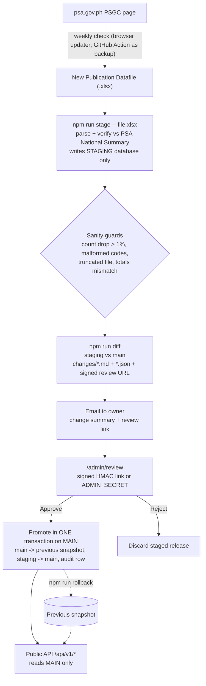

# PSGC API

A Next.js dashboard and public REST API for the **Philippine Standard Geographic Code (PSGC)** published by the
[Philippine Statistics Authority](https://psa.gov.ph/classification/psgc): every region, province, city, municipality,
sub-municipality and barangay with its official 10-digit code.

Current data: **Third Quarter 2026 PSGC Updates: Correction of the Name of One Barangay** (PSA ref. 2026-331, released 12 Oct 2026, counts as of 30 Sep 2026).

| Level | Parsed | PSA published | |
|---|---:|---:|---|
| Regions | 18 | 18 | ✓ |
| Provinces | 82 | 82 | ✓ |
| Cities | 149 | 149 | ✓ (33 HUC, 5 ICC, 111 CC) |
| Municipalities | 1,493 | 1,493 | ✓ |
| Sub-municipalities (Manila) | 14 | — | |
| Barangays | 42,010 | 42,010 | ✓ |

Per-region counts are also verified against the National Summary sheet inside PSA's workbook on every import.

- **Dashboard** (`/`): release info, stat cards, region chart, region → province → city/municipality → barangay explorer, search.
- **API docs** (`/docs`): every endpoint with params, example responses, JavaScript / Python / cURL snippets, and the integration plan.
- **Integration plan**: [`docs/INTEGRATION_PLAN.md`](docs/INTEGRATION_PLAN.md).
- **Admin review** (`/admin/review`): approve or reject staged PSA releases.

## Architecture: two databases

```
STAGING database  <- every new PSA import lands here first (npm run stage)
MAIN database     <- the ONLY database the public API reads from
```

Promotion from staging to main happens **only after explicit human approval**.



### Tables

**main**: `areas` (live data: code, level, name, normalized name, parent codes, full record as JSON), `areas_previous` (snapshot used by rollback), `release_current` / `release_previous` (release metadata), `audit_log` (approve / reject / rollback with release, time, counts, actor).

**staging**: `staged_releases` (id, version, status `pending|approved|rejected|superseded`, meta, sanity warnings, stored diff + markdown, base release), `staged_areas` (rows per staged release). Only one release can be pending; staging a new one supersedes the old. After approval, staging keeps only the latest approved release's rows.

### Sanity guards (run before a release is offered for approval)

| Code | Severity | Trigger |
|---|---|---|
| `TRUNCATED` | critical | a level is below a plausible national minimum (e.g. < 41,000 barangays) |
| `COUNT_DROP` | critical | any level's count drops by more than `GUARD_MAX_DROP_PCT` (default 1%) vs main |
| `MANY_REMOVED` | critical | more than 0.5% of all codes would be removed |
| `MALFORMED_CODES` | critical | non-10-digit codes, duplicates, orphans (no parent), unknown levels |
| `TOTALS_MISMATCH` | critical | parsed counts differ from PSA's National Summary sheet in the same workbook |
| `COUNT_JUMP` | warning | a level grows by more than 5% |
| `NOT_NEWER` | warning | staged version is not newer than main |
| `NO_CHANGES` | info | no code-level differences |

Critical warnings are shown prominently on the review page and require an extra "I acknowledge" checkbox (or `--acknowledge-warnings` on the CLI) to approve.

### Review links

`npm run stage` and `npm run diff` print `REVIEW_URL=<PUBLIC_BASE_URL>/admin/review?release=<id>&exp=<unix>&sig=<hmac>`.
The signature is `HMAC-SHA256(ADMIN_SECRET, "review:<id>:<exp>")`: tied to one staged release, expiring (`REVIEW_LINK_TTL_DAYS`, default 14), and dead once that release is approved, rejected or superseded. The page itself only shows the review; approving or rejecting is a POST with a confirmation checkbox, so mail-client link scanners can't trigger it. Admins can also sign in at `/admin/review` with `ADMIN_SECRET` (8-hour httpOnly, SameSite=Strict cookie) to see all releases, the audit log, and the rollback button. Cross-origin POSTs are refused.

## Setup

```bash
npm ci
cp .env.example .env.local      # fill in the two connection strings, ADMIN_SECRET, PUBLIC_BASE_URL
npm run db:migrate              # creates tables in both databases
npm run db:seed -- seed/PSGC-3Q-2026-Publication-Datafile.xlsx \
  --release-name "Third Quarter 2026 PSGC Updates: Correction of the Name of One Barangay" \
  --release-date 2026-10-12 --reference-no 2026-331 \
  --source-file https://psa.gov.ph/system/files/scd/PSGC-3Q-2026-Publication-Datafile.xlsx
npm run dev                     # http://localhost:3000
```

`db:seed` stages the file and promotes it as the initial approved baseline (audit actor `seed`), so main and staging start with the same 3Q 2026 data.

### Environment

| Variable | Purpose |
|---|---|
| `DATABASE_URL_MAIN` | Postgres URL of the **main** database (public API reads only this) |
| `DATABASE_URL_STAGING` | Postgres URL of the **staging** database (imports write only here) |
| `ADMIN_SECRET` | admin login + HMAC key for review links (`openssl rand -hex 32`) |
| `PUBLIC_BASE_URL` | public URL of the app, used in review links |
| `REVIEW_LINK_TTL_DAYS`, `GUARD_MAX_DROP_PCT`, `PG_POOL_MAX` | optional tuning |

Secrets are never committed (`.env*` is git-ignored except `.env.example`). The two databases can be two databases on one Neon branch, two Neon branches, or any two Postgres databases.

## Update flow (CLI)

```bash
# 1. Stage a new PSA file (writes STAGING only; prints sanity checks, diff summary and REVIEW_URL)
npm run stage -- ~/Downloads/PSGC-4Q-2026-Publication-Datafile.xlsx \
  --release-name "Fourth Quarter 2026 PSGC Updates: ..." --release-date 2027-01-12 --reference-no 2027-xxx \
  --source-file https://psa.gov.ph/system/files/scd/PSGC-4Q-2026-Publication-Datafile.xlsx
#    (npm run import is an alias; add --dry-run to only parse and verify counts)

# 2. (Re)compute the diff of the pending release vs current main, for the email
npm run diff                       # markdown to stdout, REVIEW_URL to stderr
npm run diff -- --format json      # JSON
npm run diff -- --release <id> --out summary.md
npm run diff -- --file new.xlsx    # preview any file vs main without staging it
#    Files written: changes/<release-id>.md, changes/<release-id>.json, changes/latest.md, changes/latest.json

# 3. Approve: on /admin/review (signed link) or on the CLI
npm run promote -- --release <id> --yes [--acknowledge-warnings]

#    ...or reject
npm run reject -- --release <id> --yes --note "why"

# Roll main back to the previous snapshot (run again to undo the rollback)
npm run rollback -- --yes

# Show main release, staged releases and audit log
npm run status
```

The JSON summary contains `releaseId`, `reviewUrl`, `warnings`, and `diff` with `countDelta`, `summary`, and full `added`, `removed`, `renamed`, `reparented` and `reclassified` lists (each item has code, level, name, before/after). Emailing is done outside the app: send `changes/latest.md` plus the review URL.

### Who checks PSA for new releases?

psa.gov.ph is behind a **Cloudflare challenge**: plain HTTP clients (curl, Node fetch, GitHub-hosted runners) get `HTTP 403` with a "Just a moment..." page.

1. **Primary: external browser-based weekly check.** A real browser opens https://psa.gov.ph/classification/psgc, compares the newest "PSGC Updates" release with `GET /api/v1/meta` (`version`), downloads the new Publication Datafile, runs `npm run stage -- <file>` (and `npm run diff`), and emails the owner the summary and review link. It never approves.
2. **Backup: GitHub Action `psgc-check.yml`** (shipped in `ops/github-workflows/`; move it to `.github/workflows/` to activate, see that folder's README) runs every Monday 01:00 UTC (and on demand). `scripts/check-psa.mjs` tries the page, detects the Cloudflare challenge and exits cleanly with a warning (the job stays green). If the page and file are ever reachable and the repo has `DATABASE_URL_MAIN`, `DATABASE_URL_STAGING`, `ADMIN_SECRET` secrets (and `PSGC_API_BASE_URL` variable), it stages the release, posts the summary to the job summary, uploads `changes/` as an artifact and opens a "review required" issue (disable with repo variable `PSGC_OPEN_ISSUE=false`). It never promotes.

## API

Base: `/api/v1`. JSON, CORS `*`, `Cache-Control: public, max-age=3600, s-maxage=86400, stale-while-revalidate=604800`, `X-PSGC-Version` header. Full reference with examples at `/docs`.

| Endpoint | Notes |
|---|---|
| `GET /meta` | release version, name, date, counts, promotedAt |
| `GET /regions` | 18 regions with roll-up counts |
| `GET /regions/{code}` | |
| `GET /regions/{code}/provinces` | NCR → empty |
| `GET /regions/{code}/cities-municipalities` | `province=<code>|none` |
| `GET /provinces` | `region` |
| `GET /provinces/{code}` | |
| `GET /provinces/{code}/cities-municipalities` | |
| `GET /cities-municipalities` | `region`, `province` (or `none`), `type=city|municipality|huc|icc|cc`, `name`, `page`, `limit≤2000` |
| `GET /cities-municipalities/{code}` | |
| `GET /cities-municipalities/{code}/barangays` | `subMunicipality`, `page`, `limit≤1000` |
| `GET /cities-municipalities/{code}/sub-municipalities` | Manila districts |
| `GET /sub-municipalities` | |
| `GET /barangays` | `region`, `province`, `cityMunicipality`, `subMunicipality`, `urbanRural=U|R`, `name`, `page`, `limit≤500` (default 100) |
| `GET /barangays/{code}` | |
| `GET /search?q=` | `level` (comma list), `region`, `province`, `limit≤100` |
| `GET /codes/{code}` | any level, full ancestry, accepts 9-digit correspondence codes |

Lists: `{ "data": [...], "meta": { "total", "page", "limit", "totalPages", "hasNextPage" } }`. Errors: `{ "error": { "status", "code", "message" } }`.

```bash
curl -s localhost:3000/api/v1/codes/1380100001
# {"data":{"code":"1380100001","name":"Barangay 1",...,"level":"barangay"},
#  "ancestry":{"region":{"code":"1300000000","name":"National Capital Region (NCR)"},"province":null,
#              "cityMunicipality":{"code":"1380100000","name":"City of Caloocan","type":"City","cityClass":"HUC"},"subMunicipality":null},
#  "fullName":"Barangay 1, City of Caloocan, National Capital Region (NCR)"}
```

## Data model notes

- PSGC code = `RR PPP MM BBB`. Parents are derived from code prefixes: region = first 2 digits, province = first 5, city/municipality = first 7.
- **NCR** has no provinces. Its 16 cities and Pateros have `provinceCode: null`.
- **HUCs** (33, including Lucena, which PSA treats as an HUC for statistical purposes) carry their own province-level code and `provinceCode: null`. `geographicProvinceCode` is derived from the old 9-digit correspondence code (e.g. Baguio → Benguet).
- **City of Isabela** (Region IX) sits under a special "Not a Province" grouping code `0990100000`; it's stored as a special area, the city has `specialAreaCode` set and `geographicProvinceCode` = Basilan.
- **BARMM Special Geographic Area** (`1999900000`, 8 municipalities) is also a non-province grouping; its municipalities have `specialAreaCode: "1999900000"`. **Cotabato City** is an ICC under Maguindanao del Norte in the PSA file and is kept there.
- **Manila's 14 sub-municipalities** (`SubMun`) sit between the city and its 897 barangays (`subMunicipalityCode`).
- Footnote markers in names (e.g. `City of Lucenaa/`) are stripped; trailing spaces trimmed. Province remarks such as "(excluding CITY OF BAGUIO)" are kept in `remarks`.

## Project layout

```
scripts/import-psgc.ts   stage (alias: import)       scripts/diff-psgc.ts   diff
scripts/promote.ts | reject.ts | rollback.ts | status.ts | db-migrate.ts | db-seed.ts
scripts/check-psa.mjs    PSA page check used by the GitHub Action
scripts/lib/parse-psgc.ts  workbook parser (SheetJS)
src/lib/release/ops.ts   stage / diff / promote / reject / rollback (shared by CLI and admin endpoints)
src/lib/psgc/            rows, diff, guards     src/lib/db/   pools + schema
src/app/api/v1/          public API (main DB only)
src/app/admin/review/    review page            src/app/api/admin/  approve / reject / rollback / login
seed/                    PSA 3Q 2026 publication datafile (initial baseline)
```

## Attribution

Data: Philippine Statistics Authority (PSA), Philippine Standard Geographic Code. This project is not affiliated with or endorsed by PSA.
